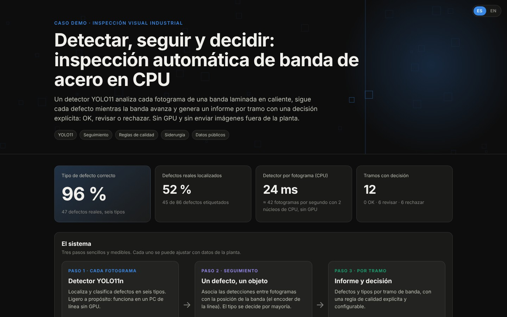

# Automatic steel strip inspection: detector + per-section report

**Interactive dashboard:** [English](https://alvaromcib.github.io/inspeccion-defectos-cascada/en/) · [Español](https://alvaromcib.github.io/inspeccion-defectos-cascada/)



Visual inspection of a moving hot-rolled steel strip in three simple, measurable steps:

1. **YOLO11n detector on every frame.** It localises defects and classifies them into six types. Lightweight on purpose: ≈24 ms per frame on 2 CPU cores, no GPU.
2. **Tracking.** Detections are linked across frames using the strip position (on a real line, the encoder), so each physical defect becomes one object, and its type is decided by majority over the frames.
3. **Per-section report** with an explicit, configurable quality rule: **OK / REVIEW / REJECT**.

Everything runs locally: plant images never leave the factory.

Demo project built on the public NEU-DET dataset (surface defects of hot-rolled steel strip). No client data is used.

## Results (12 strip sections, 251 frames, NEU-DET validation images)

| Metric | Value |
|---|---|
| Correct defect type | **95.7%** of 47 real defects |
| Labelled defects localised | 45 of 86 (52%) |
| Unique defects that match a real one | 86% |
| Detector time | ≈24 ms per frame on 2 CPU cores |
| Sections | 6 review · 6 reject |

NEU-DET only contains images with defects, so every section has findings. The demo detector finds about half of the labelled defects: with the plant's own images and higher resolution, that is the first thing to improve.

**Example decision rule** (`RULE` in `src/pipeline.py`, not learned from data): reject a section if one defect covers more than 50% of an image or there are 3 or more critical defects (inclusion, rolled-in scale); review if there is at least one defect. In a plant, the quality manager sets it per product and customer.

## Discarded experiment: a VLM as a second stage

A cascade with a local vision-language model (Qwen2.5-VL, Ollama) reviewing crops of each defect was tested and **removed**: on the same 43 defects, type accuracy dropped from 95% (detector) to 47% (3B) and 42% (7B), at 1–2 minutes per call on CPU. Details, results and logs in [`experiments/vlm/`](experiments/vlm/).

## How to run it

```bash
pip install -r requirements.txt
python src/get_data.py            # downloads NEU-DET and converts it to YOLO format (datasets/neu)
python src/pipeline.py --rows 12  # detector + tracking + per-section report -> results/inspection.json
python src/build_dashboard.py     # rebuilds docs/ (ES) and docs/en/ (EN)
```

The detector is already trained: `models/neu_yolo11n.pt`.

## How it would apply on a real line

- A line-scan or area camera over the strip or part, synchronised with the encoder, to place each defect in metres of coil.
- A detector trained on the plant's own defects, and a decision rule validated against the history of rejections.
- Integration with MES/quality systems: a report per coil or batch and traceability of each defect with its image.

---

**Álvaro Martín Coll** · Physicist · AI engineer for industry and energy · [Malt profile](https://www.malt.com/profile/alvaromartincoll)

Data: K. Song, Y. Yan, NEU surface defect database, Northeastern University (research use).
